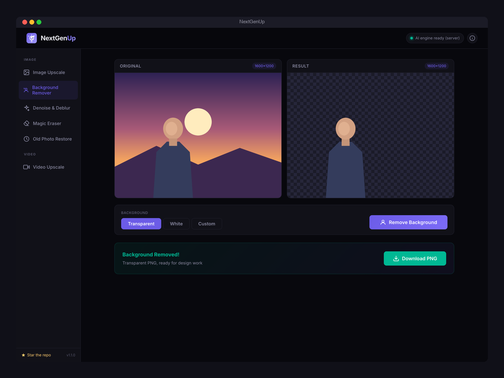
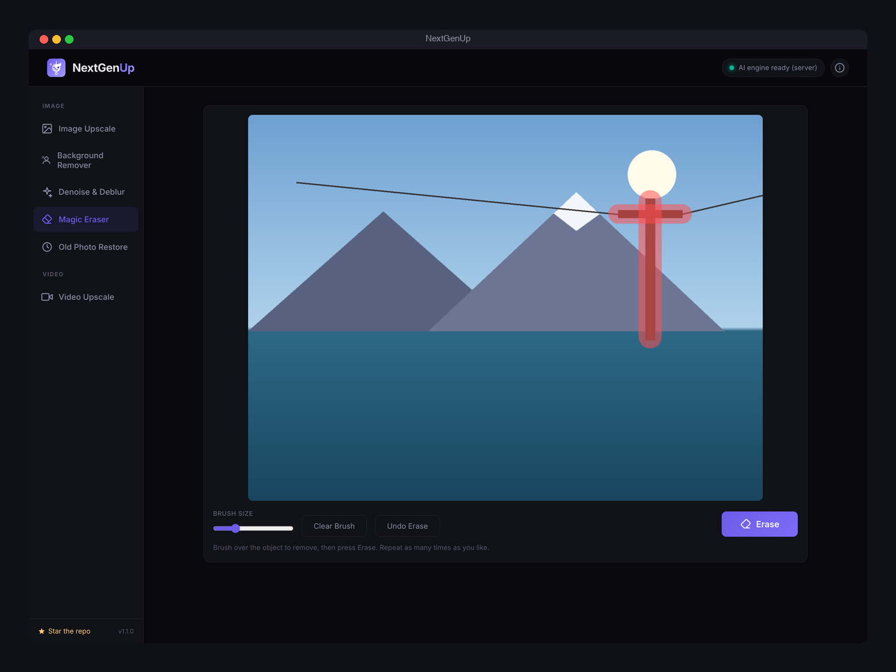
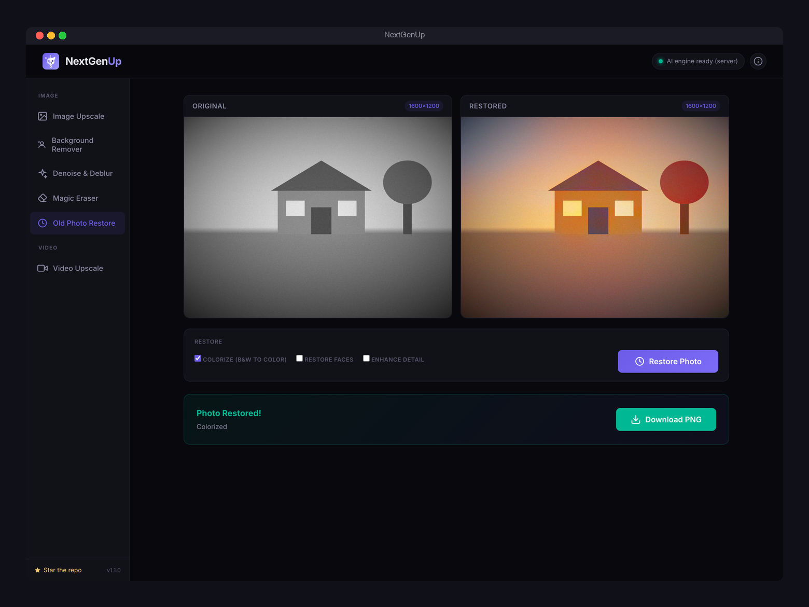
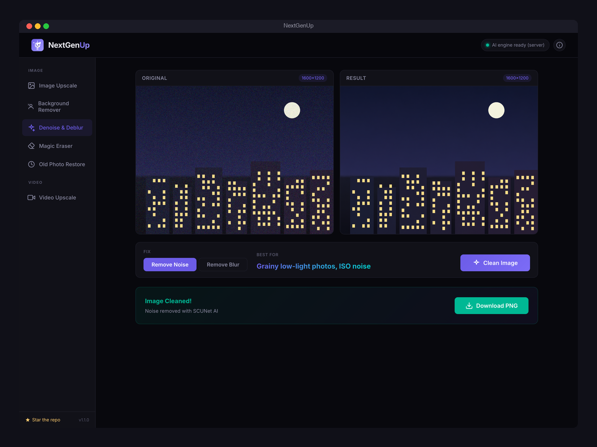
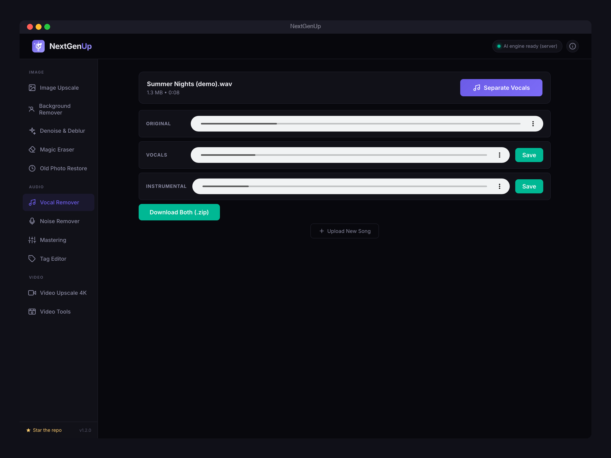
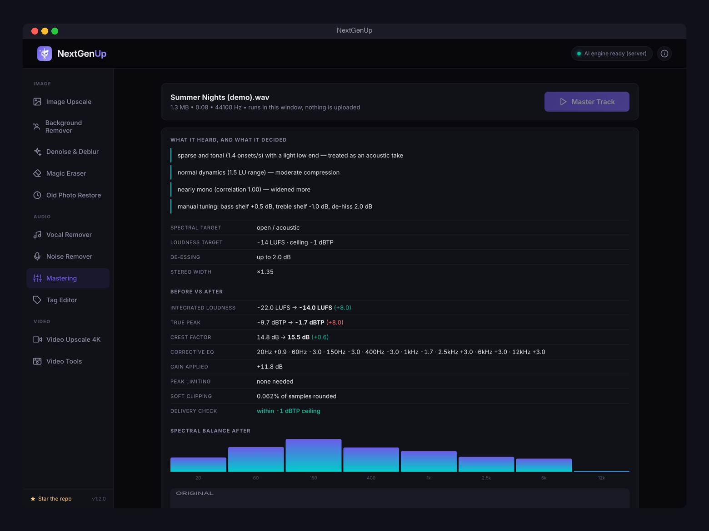
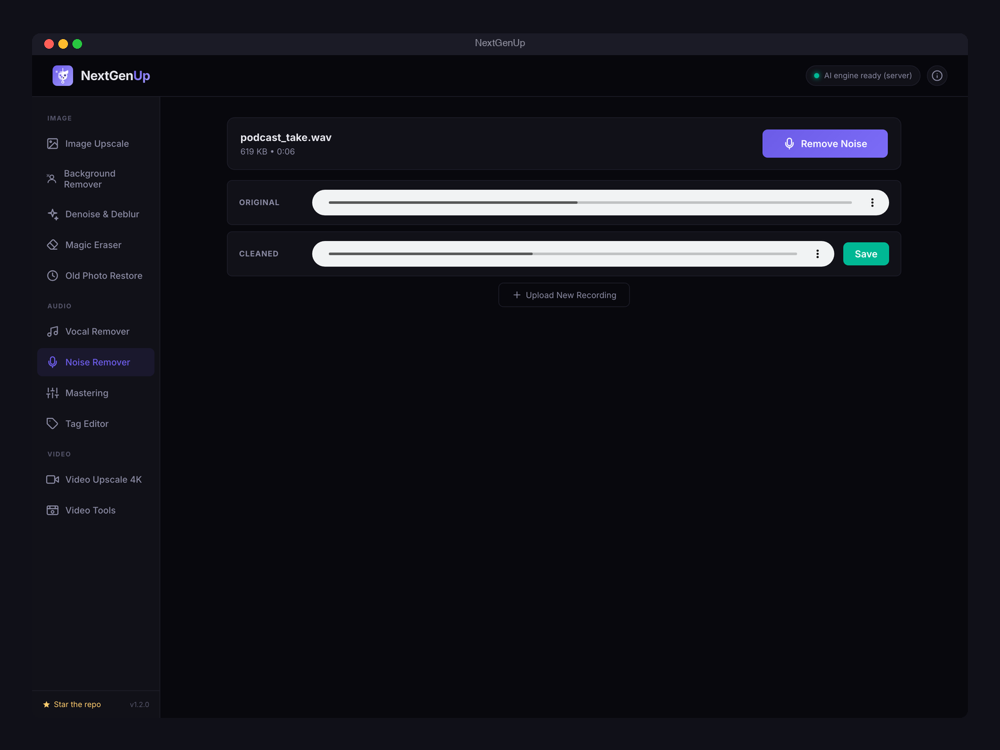
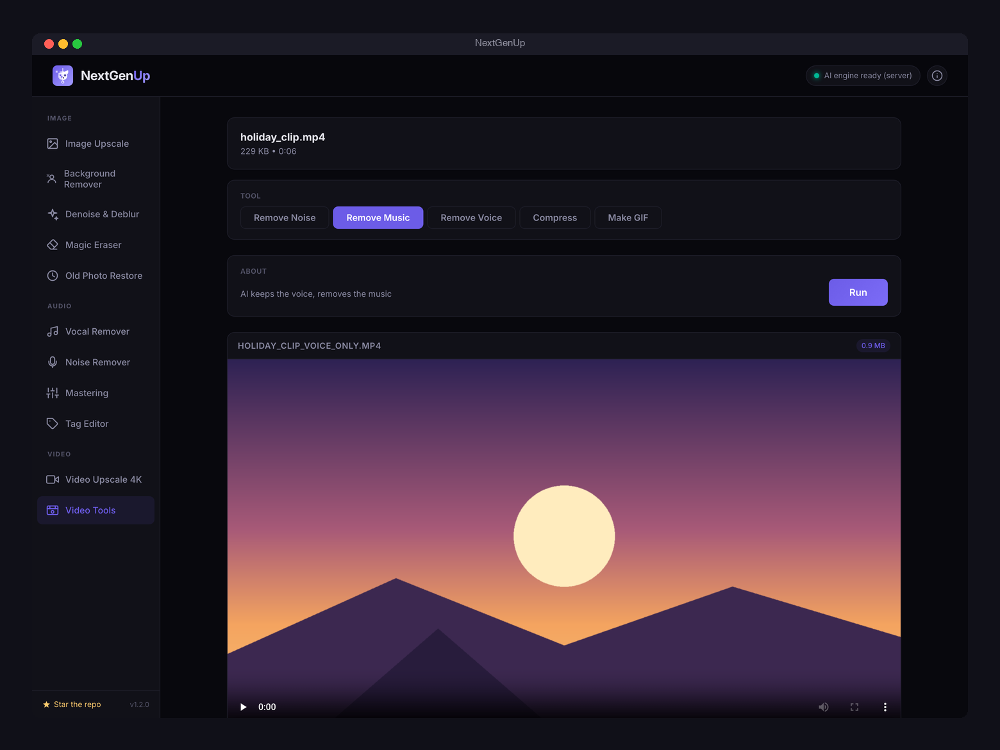

<p align="center">
  
</p>

<p align="center">
  <a href="https://github.com/riponcm/nextgenUp/releases/latest"></a>
  <a href="https://github.com/riponcm/nextgenUp/releases"></a>
  <a href="LICENSE"></a>
  <a href="https://github.com/riponcm/nextgenUp/actions/workflows/desktop.yml"></a>
  <a href="https://github.com/riponcm/nextgenUp/stargazers"></a>
</p>

**NextGenUp** is a free, open-source **AI photo, audio, and video studio**: upscale images to 8K and videos to 4K, **remove backgrounds**, **erase unwanted objects**, **denoise and deblur photos**, **colorize old black-and-white pictures**, **split songs into vocals and instrumental**, **remove background noise from recordings**, **master tracks with one click**, **compress videos to a target size**, and **remove music or noise from a video's audio** — using Real-ESRGAN, BiRefNet, LaMa, SCUNet, NAFNet, DDColor, GFPGAN, MDX-Net, and DeepFilterNet, entirely on your own machine. A free alternative to **Topaz Gigapixel AI**, **Topaz Video AI**, **remove.bg**, **Magic Eraser**, **lalal.ai / Moises**, **Adobe Podcast Enhance**, and **LANDR** with no cloud, no subscription, no watermarks, and no upload of your files to anyone's server.

A [matily.org](https://matily.org) product. Free and open source under the MIT license.

## Why NextGenUp

| | NextGenUp | Topaz Photo / Video AI | remove.bg | Upscayl | Video2X |
|---|---|---|---|---|---|
| Price | Free, MIT | ~$199/year | ~$0.20+/image | Free | Free |
| Image upscaling | Yes, to 8K | Yes | No | Yes | No |
| Video upscaling | Yes, to 4K | Yes | No | No | Yes |
| Background removal | Yes (BiRefNet) | No | Yes | No | No |
| Object eraser (magic eraser) | Yes (LaMa) | No | No | No | No |
| Denoise and deblur | Yes (SCUNet / NAFNet) | Yes | No | No | No |
| Old photo colorization | Yes (DDColor) | No | No | No | No |
| Face restoration | Yes (GFPGAN) | Yes | No | No | No |
| Same-size enhance mode | Yes | Yes | No | No | No |
| Vocal remover / stem splitter | Yes (MDX-Net) | No | No | No | No |
| Audio noise removal | Yes (DeepFilterNet3) | No | No | No | No |
| One-click mastering | Yes, with tuning | No | No | No | No |
| Video compressor and GIF maker | Yes | No | No | No | No |
| Batch + zip export | Yes | Yes | Paid API | Yes | Partial |
| Runs fully offline | Yes | Yes | No (cloud) | Yes | Yes |
| Also usable from any browser on your network | Yes | No | n/a | No | No |

And on the audio side, the same tools replace **lalal.ai / Moises** (~$10/month for stem separation), **Adobe Podcast Enhance** (cloud noise removal), and **LANDR / eMastered** (~$12/month mastering) — offline, unlimited, and free.

Excellent tools all around — NextGenUp's niche is covering **images, audio, video, faces, backgrounds, and restoration** in one simple app that is free forever.

---

## Download

| Your computer | Download | Notes |
|---|---|---|
| **Windows** 10 / 11 | [NextGenUp-Windows-Setup.exe](https://github.com/riponcm/nextgenUp/releases/latest/download/NextGenUp-Windows-Setup.exe) | Most users. SmartScreen may ask once: click **More info**, then **Run anyway** |
| **Mac** with Apple Silicon (M1, M2, M3, M4) | [NextGenUp-Mac-AppleSilicon.dmg](https://github.com/riponcm/nextgenUp/releases/latest/download/NextGenUp-Mac-AppleSilicon.dmg) | Macs from 2020 onward. Not sure? Apple menu > About This Mac > "Chip" |
| **Mac** with Intel | [NextGenUp-Mac-Intel.dmg](https://github.com/riponcm/nextgenUp/releases/latest/download/NextGenUp-Mac-Intel.dmg) | Macs from 2019 and earlier |
| **Linux** | [NextGenUp-Linux.AppImage](https://github.com/riponcm/nextgenUp/releases/latest/download/NextGenUp-Linux.AppImage) | Any distribution. `chmod +x` then run. An RPM is also on the release page |

Every installer is fully self-contained — the AI engine, FFmpeg, and the upscaling models are bundled. Install, open, upscale. The app checks for updates on launch and installs them with one click (signed releases).

macOS note: builds are not notarized with Apple; on first launch, right-click the app and choose Open.

## Demo video

<p align="center">
  <a href="https://www.youtube.com/watch?v=tyuIr6J_iZk">
    
  </a>
</p>

<p align="center">
  <a href="https://www.youtube.com/watch?v=tyuIr6J_iZk">Watch the 30-second demo</a> — a full tutorial is coming soon on <a href="https://www.youtube.com/@matilylabs">our YouTube channel</a>, subscribe to catch it.
</p>

## Screenshots

<p align="center">
  
</p>

<p align="center">
  
</p>

<p align="center">
  
</p>

<p align="center">
  
</p>

<p align="center">
  
</p>

<p align="center">
  
</p>

<p align="center">
  
</p>

<p align="center">
  
</p>

<p align="center">
  
</p>

<p align="center">
  
</p>

<p align="center">
  
</p>

<p align="center">
  
</p>

## Features

| | |
|---|---|
| Image upscaling | Four modes — Quick (browser AI), Quality (FFmpeg), Enhance (same size, AI cleanup), Ultra (server AI, works from any device) |
| Background remover | BiRefNet segmentation with feathered edges — transparent PNG, white, or any custom color background |
| Denoise and deblur | SCUNet removes grain and ISO noise; NAFNet removes motion blur and camera shake |
| Magic Eraser | Brush over people, wires, trash, or photobombers and LaMa inpainting removes them — repeat as often as you like, with undo |
| Old Photo Restore | DDColor colorizes black-and-white photos; combine with face restoration and detail enhancement in one pass |
| Vocal Remover | MDX-Net (Kim Vocal 2) splits any song into vocals and instrumental — karaoke tracks, acapellas, samples — with per-stem preview and zip export |
| Noise Remover (audio) | DeepFilterNet3 speech enhancement, the same engine as the official DeepFilterNet — podcasts, voice memos, interviews |
| Mastering | One-click automatic mastering that measures the track and explains every decision, plus a tuning panel (tone, bass, treble, de-hiss, loudness, width) and a loudness-matched A/B player — entirely in your browser |
| Tag Editor | View, strip, or replace MP3/WAV metadata losslessly; the audio is verified bit-for-bit identical |
| Video upscaling | Basic (FFmpeg Lanczos + CAS sharpening) and Pro (Real-ESRGAN, frame by frame), single or bulk |
| Video Tools | Remove noise, music, or voice from a video's audio track (picture untouched), compress to a target size (Discord, email, WhatsApp presets), make GIFs |
| Enhance mode | Keep the original resolution but reconstruct detail — noise, blur, and JPEG artifacts removed |
| Face restoration | GFPGAN v1.4 — detected faces are aligned, restored, and seamlessly blended back |
| Batch processing | Drop multiple images or videos, process them all, download results individually or as one zip |
| On-demand AI models | The optional models download on first use with a progress bar, so the installer stays small |
| Before/after slider | Drag a divider across the result to compare against the original |
| Cancellable jobs | Every job can be cancelled mid-run; switch modes and restart instantly |
| Portrait and landscape | Orientation handled automatically; output capped at 4K (video) / 8K (image) |
| Auto-updates | Desktop app updates itself from GitHub releases (cryptographically signed) |

## How to use

1. Open NextGenUp and pick a tool in the sidebar:

   | Tool | What it does |
   |------|--------------|
   | Image Upscale | Quick (browser AI), Quality (FFmpeg), Enhance (same size), or Ultra (server AI) — 2x or 4x, up to 8K |
   | Background Remover | Cut the subject out to a transparent PNG, or place it on white or any color |
   | Denoise & Deblur | Remove Noise for grainy low-light photos; Remove Blur for motion blur and camera shake |
   | Magic Eraser | Brush over anything unwanted, press Erase, repeat — with undo |
   | Old Photo Restore | Colorize black-and-white photos, restore faces, and enhance detail in one pass |
   | Vocal Remover | Split a song into vocals and instrumental (karaoke / acapella) |
   | Noise Remover | Clean background noise out of speech recordings |
   | Mastering | One-click master with measurement, explanations, tuning, and A/B comparison |
   | Tag Editor | Strip or rewrite MP3/WAV tags without touching the audio |
   | Video Upscale 4K | Basic (fast FFmpeg) or Pro (frame-by-frame AI) — drop several videos for a batch queue |
   | Video Tools | Remove noise / music / voice from the audio, compress to a size, or make a GIF |

2. Drop a file onto the dropzone (or click to browse — select several files for batch mode).
3. Press the action button. If a tool's AI model is not installed yet, it downloads once with a progress bar and then runs.
4. Watch the live progress (cancel any time), compare the result, and download — single files or everything as one zip.

For portraits, tick **Restore faces** (Ultra mode and Old Photo Restore) to run GFPGAN face restoration on every detected face.

## Run from source (web app)

The same interface also runs as a self-hosted web app that any device on your network can use.

Requirements: Python 3.10–3.13 and FFmpeg (`brew install ffmpeg` / `apt install ffmpeg`).

```bash
git clone https://github.com/riponcm/nextgenUp.git
cd nextgenUp
./setup.sh
source venv/bin/activate
python app.py
```

Open http://localhost:5000, or `http://<your-ip>:5000` from other devices. Browser AI modes need WebGPU (Chrome/Edge 113+) on secure origins; the Ultra mode works from any browser on any device.

## How it works

```
Browser / app window                 Local server
--------------------                 ------------
upload image or video  ───────────►  Pillow / ffprobe read metadata

Quality & Basic modes  ───────────►  FFmpeg: Lanczos scale + CAS + unsharp

Quick / Enhance / Pro
  ONNX Runtime Web (WebGPU/WASM)
  Real-ESRGAN in a Web Worker
  tile-based inference               Ultra mode
  frames sent back      ───────────►  Real-ESRGAN via ONNX Runtime (CPU)
                                      GFPGAN face restoration
                                      FFmpeg assembles video + audio
```

The upscaling model is [Real-ESRGAN](https://github.com/xinntao/Real-ESRGAN) (`realesr-general-x4v3`, ~5 MB ONNX, bundled). The other tools use optional ONNX models that download on first use into the app's data folder: BiRefNet-lite (~224 MB, background removal), SCUNet (~77 MB, denoise), NAFNet (~92 MB, deblur), DDColor-tiny (~135 MB, colorization), LaMa (~208 MB, object removal), Kim Vocal 2 (~67 MB, vocal separation), and DeepFilterNet3 (~8 MB, audio noise removal) — all MIT or Apache-2.0 licensed. Mastering and the Tag Editor need no model at all: they are pure DSP running in a Web Worker inside the page. Images are processed in overlapping tiles or windows so any resolution fits in memory; inference runs in a Web Worker (browser) or a background thread (server) so the interface never freezes. Completed tasks persist in SQLite, and files older than 24 hours are cleaned up automatically.

## Configuration

| Environment variable | Default | Purpose |
|----------------------|---------|---------|
| `PORT` | `5000` | Server port |
| `CLEANUP_HOURS` | `24` | Files older than this are deleted |
| `FLASK_DEBUG` | `0` | Set to `1` for the Werkzeug debugger (never on an exposed host) |

Upload limit is 2 GB. Face restoration requires the GFPGAN model (~340 MB): answer yes in `setup.sh`, or for the desktop app drop `GFPGANv1.4.onnx` into the app-data `models/` folder.

## Project layout

```
app.py                     Flask server: upload, process, progress, download, zip
ai_engine.py               Server-side Real-ESRGAN (ONNX Runtime, tiled)
bg_remove.py               BiRefNet background removal
restore_engine.py          SCUNet denoise, NAFNet deblur, DDColor colorize, LaMa inpaint
model_store.py             Registry + on-demand downloader for the optional AI models
audio_engine.py            MDX-Net vocal separation, DeepFilterNet3 noise removal
video_tools.py             Video audio cleanup, two-pass compressor, GIF maker
face_restore.py            GFPGAN face restoration + YuNet detection
paths.py                   Dev vs. packaged path resolution
templates/index.html       Dashboard (all tools)
static/js/app.js           Video controller (single + batch), navigation, About dialog
static/js/image-app.js     Image upscale controller: modes, batch, compare slider
static/js/bg-app.js        Background remover controller
static/js/tools-app.js     Denoise/deblur, Magic Eraser, and Old Photo Restore controllers
static/js/audio-app.js     Vocal Remover, Noise Remover, Mastering, Tag Editor controllers
static/js/vtools-app.js    Video Tools controller
static/js/vendor/          ReMaster mastering + tag-surgery core (worker bundle)
static/js/pro-worker.js    ONNX inference worker (tiling, WebGPU/WASM)
src-tauri/                 Desktop shell (Tauri 2): sidecar, auto-updater
nextgenup-server.spec      PyInstaller build for the bundled server
.github/workflows/         CI: signed installers for all platforms
```

## Building and releasing the desktop app

Releases are built by GitHub Actions. Bump the version in `src-tauri/tauri.conf.json` and `app.py`, then:

```bash
git tag v1.0.1
git push origin v1.0.1
```

Installers for macOS (Intel and Apple Silicon), Windows x64, and Linux are compiled, signed for auto-update, and attached to the GitHub release automatically. Existing installations pick the update up on next launch.

## Roadmap

- Frame interpolation and AI slow motion (RIFE) — 24 to 60/120 fps
- Video background removal (Robust Video Matting)
- Larger server models (Real-ESRGAN x4plus, HAT) for a maximum-quality tier
- Face restoration for video frames
- One-button automatic photo restoration pipeline

## Frequently asked questions

**Is NextGenUp really free?**
Yes. NextGenUp is completely free and open source under the MIT license — no trial, no subscription, no watermark, no account. It is maintained by [Matily](https://matily.org).

**Is NextGenUp a good free alternative to Topaz Gigapixel AI or Topaz Video AI?**
Yes, for most use cases. NextGenUp uses Real-ESRGAN — the same family of super-resolution models used by many commercial tools — and covers both image and video upscaling plus GFPGAN face restoration in one app. Topaz still holds an edge on some fine detail at extreme zoom, but for web, social media, prints, and AI-generated media, results are comparable at zero cost.

**Does NextGenUp upload my photos or videos to the cloud?**
No. Everything runs locally on your machine — the AI models, FFmpeg, and the server all execute on your own hardware. Your files never leave your computer.

**What AI models does NextGenUp use?**
Real-ESRGAN for super-resolution, BiRefNet for background removal, LaMa for object removal, SCUNet for denoising, NAFNet for deblurring, DDColor for colorization, GFPGAN v1.4 for face restoration, YuNet for face detection, MDX-Net (Kim Vocal 2) for vocal separation, and DeepFilterNet3 for audio noise removal — all running locally through ONNX Runtime, all under MIT or Apache-2.0 licenses. Mastering and tag editing use hand-written DSP that runs in the browser.

**Is NextGenUp a free alternative to remove.bg?**
Yes. The Background Remover uses BiRefNet, a state-of-the-art segmentation model, and outputs a transparent PNG (or any background color you choose) with no per-image fees, no signup, and no upload — including batch removal with zip export.

**How do I remove an object or a person from a photo?**
Open Magic Eraser, drop your photo, brush over whatever you want gone, and press Erase. LaMa inpainting reconstructs the background behind the object. You can brush and erase repeatedly, and undo any step.

**Can it colorize old black-and-white photos?**
Yes. Old Photo Restore uses DDColor to add realistic color to black-and-white or sepia photos. Tick "Restore faces" and "Enhance detail" to also repair faces and recover sharpness in the same pass.

**Do the AI models make the app download huge?**
No. The installer ships only the small upscaling model. The optional tools (background removal, denoise, deblur, colorize, eraser, vocal separation, audio noise removal) each download their model once on first use, with a progress bar, ranging from 8 MB to 224 MB. Tools you never open download nothing.

**Is there a free vocal remover or stem splitter like lalal.ai or Moises?**
Yes. NextGenUp's Vocal Remover uses MDX-Net (Kim Vocal 2), one of the best-rated open separation models, to split any song into a vocals stem and an instrumental stem locally — for karaoke tracks, acapellas, remixes, or sampling. No per-minute fees, no upload, and you can preview each stem and download both as a zip.

**How do I remove background noise from a recording or podcast for free?**
Open Noise Remover and drop the file. NextGenUp runs DeepFilterNet3, the same speech-enhancement engine as the official DeepFilterNet project (its output is numerically identical), so hiss, fan noise, traffic, and room tone are removed while the voice stays natural. Video Tools does the same for a video's audio track without re-encoding the picture.

**Can NextGenUp master a song automatically?**
Yes. Mastering measures the track (loudness, true peak, dynamics, spectral balance, stereo width), decides every setting from what it hears, explains each decision in plain language, and lets you A/B the result loudness-matched against the original. A tuning panel exposes tone target, correction strength, bass, treble, de-hiss, loudness target, and stereo width, so you can nudge the automatic master to taste. It runs entirely in the app window; nothing is uploaded. Output is 24-bit WAV.

**How do I remove music from a video but keep the voice?**
Video Tools → Remove Music. The audio track is separated with MDX-Net, the voice stem is kept, and it is remuxed with the original video stream — the picture is copied, not re-encoded. Remove Voice does the opposite (a karaoke video), and Remove Noise cleans the speech.

**How do I compress a video for Discord, WhatsApp, or email?**
Video Tools → Compress, pick a target size (10 MB Discord, 25 MB email, 100 MB WhatsApp, or custom), and NextGenUp runs a two-pass H.264 encode that lands on that size. Make GIF converts a clip to a palette-optimized animated GIF.

**Does the Tag Editor change my audio?**
No. It performs byte-level surgery on the metadata blocks (ID3v2, ID3v1, APE, RIFF INFO, and others), the audio payload is copied unchanged, and the file is hashed before and after to prove it is bit-for-bit identical. You can strip every tag or write your own title, artist, album, year, genre, track, and comment.

**How do I upscale a video to 4K?**
Open the Video Upscale tab, drop in your video, choose Basic (fast) or Pro (AI), select 4x, and press Start Upscaling. A 720p video becomes 4K (3840x2160); portrait videos are handled automatically. Audio is preserved.

**Can it fix blurry faces in old photos?**
Yes. Select Ultra mode and tick "Restore faces" — every detected face is aligned, restored with GFPGAN, and blended back seamlessly. This works especially well on old, scanned, or compressed photos.

**Can I make an image clearer without changing its size?**
Yes — that is the Enhance mode. The AI upscales 4x internally to reconstruct detail, then downscales back to the original dimensions, removing noise, blur, and JPEG artifacts while keeping the exact resolution.

**What platforms does NextGenUp support?**
Desktop apps for macOS (Apple Silicon and Intel), Windows 10/11 x64, and Linux (AppImage/deb). It also runs as a self-hosted web app usable from any browser on your network, including phones and tablets.

**Do I need a GPU?**
No. Browser modes use WebGPU when available and fall back to WASM; the server modes run on CPU. A GPU makes things faster but nothing requires one.

**How is NextGenUp different from Upscayl or Video2X?**
Upscayl upscales images only; Video2X handles video but is more technical to set up. NextGenUp covers images, video, and face restoration in one point-and-click app, and can also serve its interface to other devices on your network.

## Support the project

If NextGenUp is useful to you, please [star the repository](https://github.com/riponcm/nextgenUp) — it is the simplest way to help other people discover a free alternative to paid upscalers. Sharing the project with anyone who works with old photos, AI-generated media, or low-resolution video helps just as much. Issues and pull requests are welcome.

## Acknowledgements

NextGenUp stands on excellent open work:

- [Real-ESRGAN](https://github.com/xinntao/Real-ESRGAN) (Xintao Wang et al.) — super-resolution models
- [BiRefNet](https://github.com/ZhengPeng7/BiRefNet) (Zheng Peng et al.) — background segmentation
- [LaMa](https://github.com/advimman/lama) (Samsung AI) — large-mask inpainting for the Magic Eraser
- [SCUNet](https://github.com/cszn/SCUNet) (Kai Zhang et al.) — real-world image denoising
- [NAFNet](https://github.com/megvii-research/NAFNet) (Megvii Research) — image deblurring
- [DDColor](https://github.com/piddnad/DDColor) (Xiaoyang Kang et al.) — photo colorization
- [GFPGAN](https://github.com/TencentARC/GFPGAN) (Tencent ARC) — face restoration
- [YuNet](https://github.com/opencv/opencv_zoo) (OpenCV Zoo) — face detection
- [MDX-Net / Kim Vocal 2](https://github.com/Anjok07/ultimatevocalremovergui) (KimberleyJensen, UVR community) — vocal separation
- [DeepFilterNet](https://github.com/Rikorose/DeepFilterNet) (Hendrik Schröter et al.) — speech noise removal
- [ReMaster](https://github.com/riponcm/ReMaster-Pro) (Matily) — mastering chain and lossless tag surgery
- [FFmpeg](https://ffmpeg.org) — video processing (bundled builds are GPL; FFmpeg keeps its own license)
- [ONNX Runtime](https://onnxruntime.ai) — AI inference on server and in the browser
- [Tauri](https://tauri.app) — desktop shell
- [Flask](https://flask.palletsprojects.com) — local server

Model weights keep the licenses of their upstream projects (MIT / Apache-2.0); they are downloaded from their public releases on first use, never bundled or re-hosted.

Built and maintained by [Matily](https://matily.org), with [projectmem](https://github.com/riponcm/projectmem) providing persistent project memory during development.

## License

[MIT](LICENSE) © 2026 Ripon Chandra Malo / matily.org
